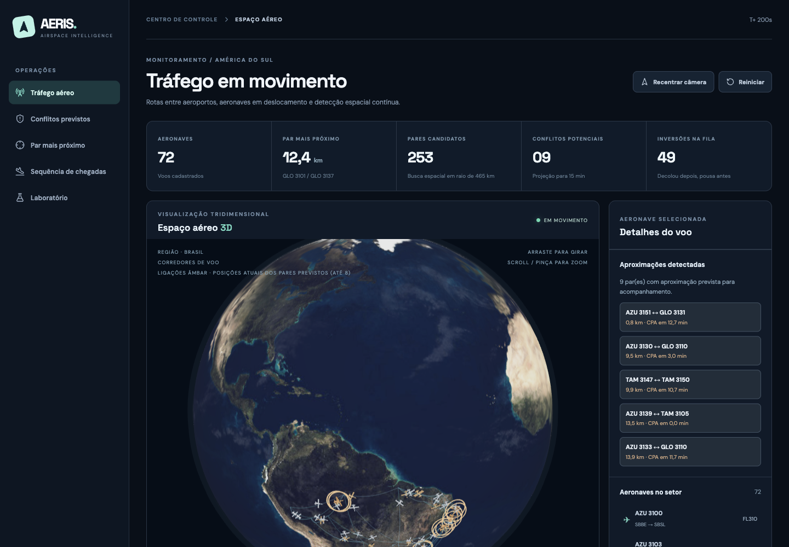
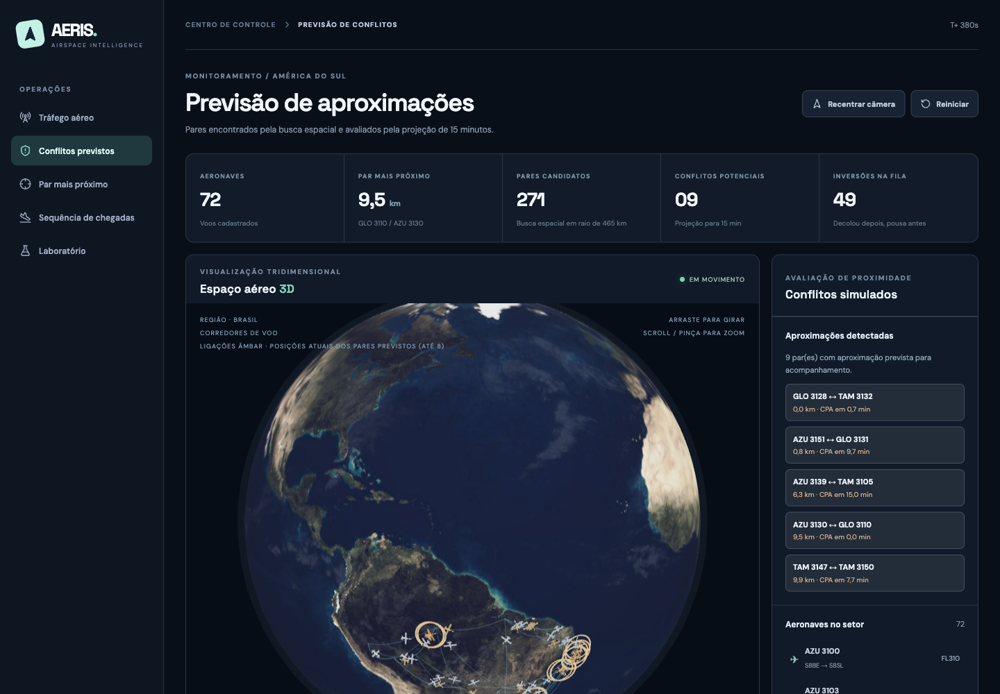
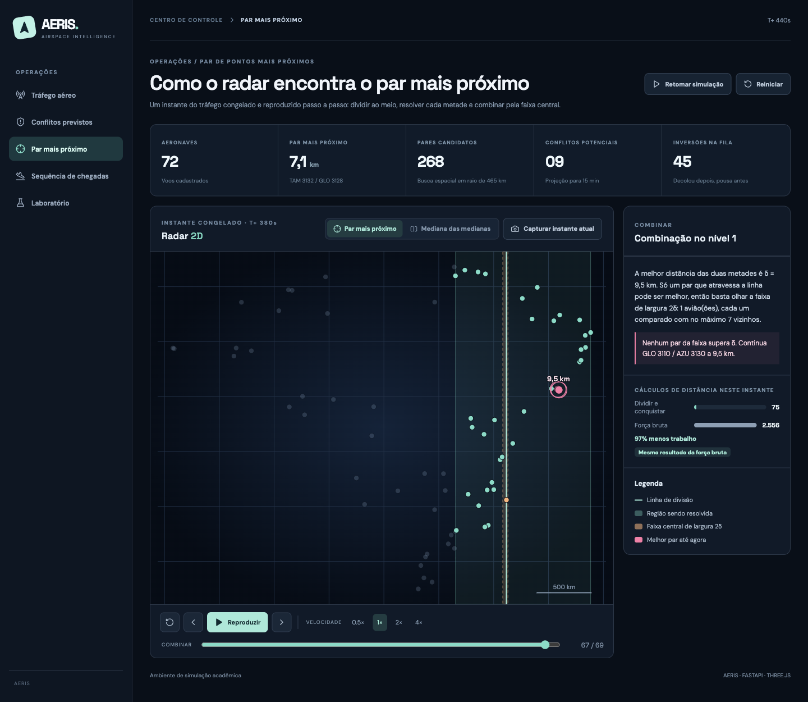
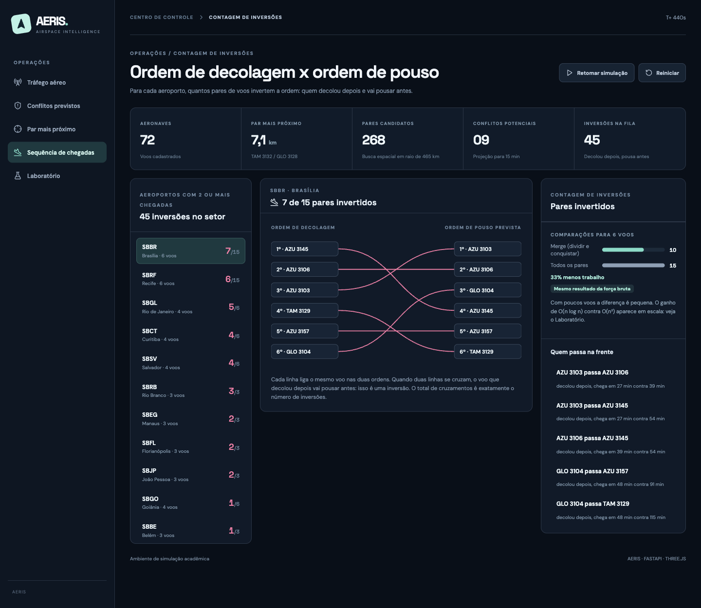
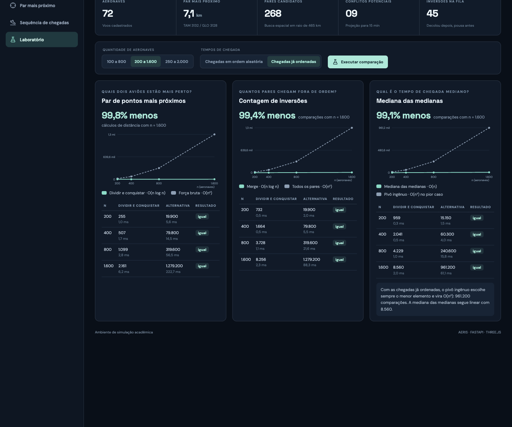

🇧🇷 [Português](README.md) | 🇺🇸 **English**

<h1>AERIS - Air Traffic Simulator with Divide and Conquer</h1>

## 🎥 Demo Video

▶️ [Watch the AERIS demo on YouTube](https://youtu.be/6HbT8gRPJSE)

<p align="center">
  <br><br>
  <br><br>
  <br><br>
  <br><br>
  
</p>

---

## About

AERIS is an academic 3D air traffic simulator. It tracks 72 synthetic flights between airports in every region of Brazil and uses **divide and conquer** algorithms to answer questions that air traffic control asks all the time:

| Question | Algorithm | Location | Complexity | Compared with |
| -- | -- | -- | -- | -- |
| Which two aircraft are closest right now? | Closest Pair of Points | [`closest_pair.py`](backend/app/divide_and_conquer/closest_pair.py) | O(n log n) | Brute force, O(n²) |
| How many flights that took off later will land earlier? | Inversion Counting | [`inversions.py`](backend/app/divide_and_conquer/inversions.py) | O(n log n) | Checking every pair, O(n²) |
| Where to split the airspace in half without sorting the aircraft? | Median of Medians | [`median_of_medians.py`](backend/app/divide_and_conquer/median_of_medians.py) | O(n) | Naive pivot, O(n²) in the worst case |

**Closest Pair of Points.** The aircraft are sorted by x and by y only once. At each step, a vertical line splits the group into two equal halves and the algorithm solves each half. When combining, it only looks at the central strip of width 2δ, where δ is the best distance found in the halves, and compares each aircraft with at most 7 neighbours. Every step is recorded and replayed on screen.

**Inversion Counting.** For each airport, flights are placed in takeoff order and compared with the expected landing order. An inversion is a pair in which the flight that took off later will land earlier. Counting happens during the merge: when a flight from the right half moves ahead, it is inverted with every flight still left in the left half.

**Median of Medians.** The search for candidate pairs is also divide and conquer. To split each group in half without sorting, it uses the Median of Medians: it splits the aircraft into groups of 5, takes the median of each group and uses the median of those medians as the pivot. This guarantees finding the middle aircraft in O(n).

The search radius is computed from the fastest aircraft speed and the 15-minute window (about 465 km today), so aircraft that are far apart now but may get closer are still evaluated. Candidate pairs go through a 15-minute closest point of approach (CPA) projection with vertical separation, which classifies potential conflicts. Every number on screen comes from the real execution, and each result is checked against brute force on every update.

## Installation

**Language:** Python 3.12 (back end) and TypeScript (front end)<br>
**Framework:** FastAPI (back end), React with Three.js and Vite (front end)<br>

**Option 1: Docker.** Requirement: Docker with Docker Compose.

```bash
docker compose up --build
```

**Option 2: without Docker.** Requirements: Python 3.12 or newer and Node.js 20 or newer. In one terminal, start the API:

```bash
cd backend
python3 -m venv .venv
source .venv/bin/activate
pip install -r requirements.txt
uvicorn app.main:app --port 8000
```

In another terminal, start the interface:

```bash
cd frontend
npm install
npm run dev
```

In both options:

- Interface: http://localhost:5173
- API documentation: http://localhost:8000/docs

To run the 39 automated tests, where each algorithm is checked against brute force:

```bash
cd backend
pytest -q
```

## Usage

The simulation starts running at 20× speed. The interface is in Portuguese. In the side menu:

1. **Tráfego aéreo** (air traffic, `#trafego`): drag to rotate the globe, scroll to zoom and click an aircraft to see origin, destination, altitude, speed and estimated arrival. The controls below the globe pause, change the speed (1×, 10×, 20× and 60×) and show or hide routes and labels.
2. **Conflitos previstos** (predicted conflicts, `#conflitos`): pairs found by the spatial search and evaluated by the 15-minute projection. On the globe, amber lines connect up to 8 predicted pairs.
3. **Par mais próximo** (closest pair, `#par-mais-proximo`): freezes a moment of traffic and replays the algorithm. Use **Reproduzir** (play), the step buttons or the timeline, at speeds from 0.5× to 4×. The *Dividir* (divide) phase shows the split lines, and the *Combinar* (combine) phase shows the region, the central strip and the best pair. The **Mediana das medianas** tab shows the splits of the radius search. **Capturar instante atual** freezes a new moment.
4. **Sequência de chegadas** (arrival sequence, `#fila-de-pouso`): choose an airport on the left. Hover over a pair under *Quem passa na frente* (who moves ahead) to highlight the matching crossing.
5. **Laboratório** (laboratory, `#laboratorio`): choose the number of aircraft and the arrival time order, then click **Executar comparação** (run comparison). With *Chegadas já ordenadas* (already sorted arrivals), the naive pivot degrades to O(n²) while the Median of Medians stays linear.

Each screen has its own address (for example, http://localhost:5173/#laboratorio).

## Other

### Project structure

```text
backend/app/
├── main.py                       API routes
├── laboratory.py                 comparisons at growing scale
├── divide_and_conquer/
│   ├── closest_pair.py           closest pair of points (and brute force)
│   ├── inversions.py             inversion counting (and brute force)
│   └── median_of_medians.py      median of medians (and naive pivot)
└── airspace/
    ├── simulation.py             flight movement and snapshots
    ├── proximity.py              radius search split by the median, and CPA
    ├── landing_sequence.py       arrival sequence per airport
    ├── geography.py              airports and regional flat projection
    ├── flight_repository.py      SQLite reader
    └── flight_routes.sqlite3     72 synthetic flights
frontend/src/
├── App.tsx                       navigation and simulation loop
├── globe/                        3D globe (Three.js)
├── traffic/                      traffic and conflict screens
├── algorithms/                   2D radar and step player
├── landing/                      arrival sequence
└── laboratory/                   performance laboratory
```

### Laboratory results (n = 1,600)

| Algorithm | Divide and conquer | Naive alternative |
| -- | -- | -- |
| Closest Pair of Points | 2,161 distance computations | 1,279,200 |
| Inversion Counting (random arrivals) | 15,045 comparisons | 1,279,200 |
| Median of Medians (already sorted arrivals) | 8,560 comparisons | 961,200 |
| Median of Medians (random arrivals) | 12,473 comparisons | 5,170 |

The last row shows a case where divide and conquer loses. With random data, the naive pivot usually works well and does less work. The advantage of the Median of Medians is the O(n) guarantee in the worst case too.

### How comparisons are measured

The main metric is the number of operations (distance computations or comparisons), which does not depend on the machine. Time in milliseconds is shown as a complement. In the radius search, the divide and conquer total adds the distance computations and the comparisons spent finding the medians.

### Limitations

- The data is synthetic. Movement uses linear interpolation on the regional projection and arc-shaped visual routes on the globe, without real airways, winds or procedures.
- When an aircraft finishes its route, it restarts at the origin to keep the demo running.
- Altitude is constant, the CPA projection assumes constant speed and distances use a regional flat approximation. The conflict thresholds are for teaching only.
- The API keeps the simulation state in memory and assumes a single shared session.
- This is not certified aviation software and must not be used for real decisions.

---

## Contributors

| [Camila Cavalcante](https://github.com/CamilaSilvaC) | [Luísa Ferreira](https://github.com/luisa12ll) |
| :---: | :---: |
|  |  |
