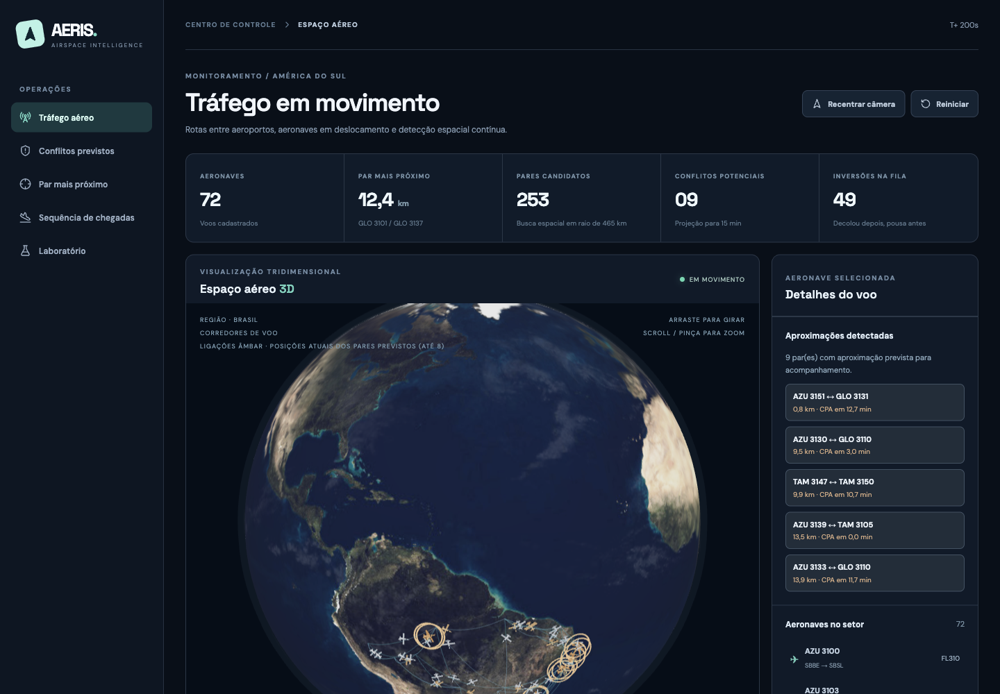
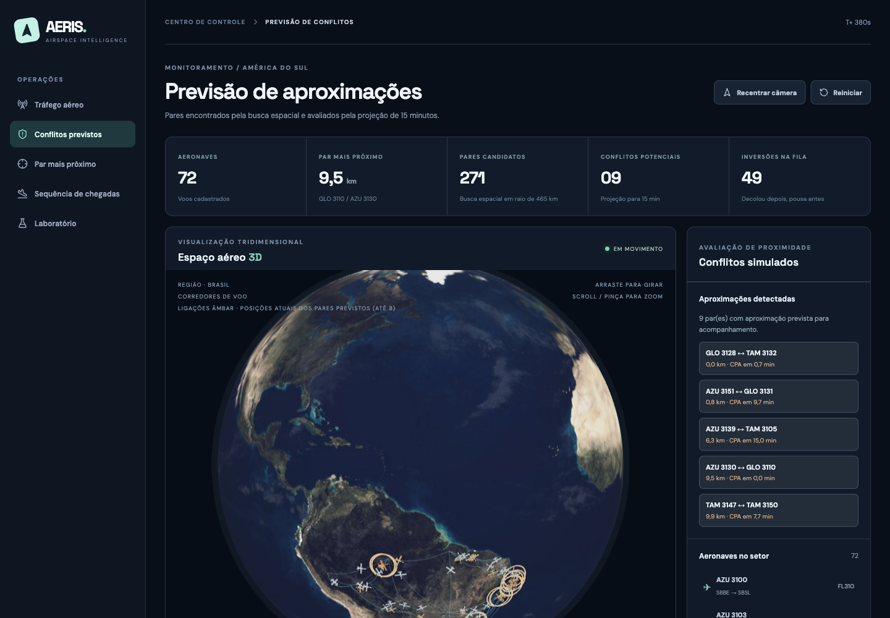
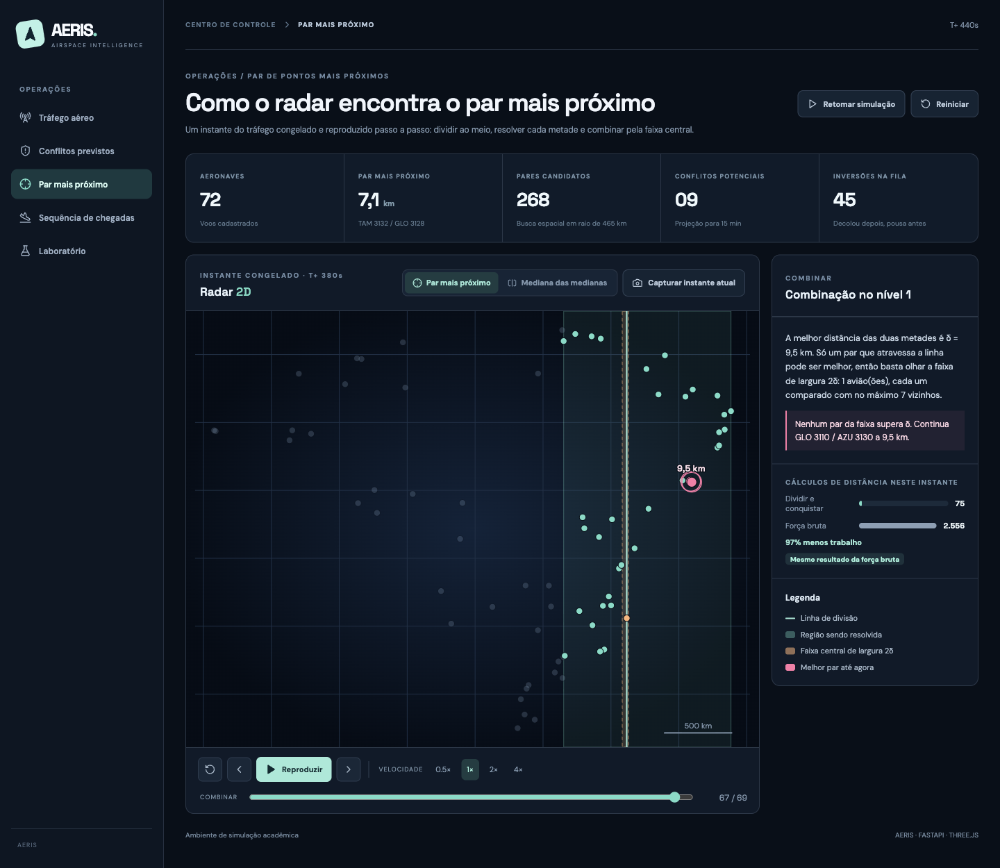
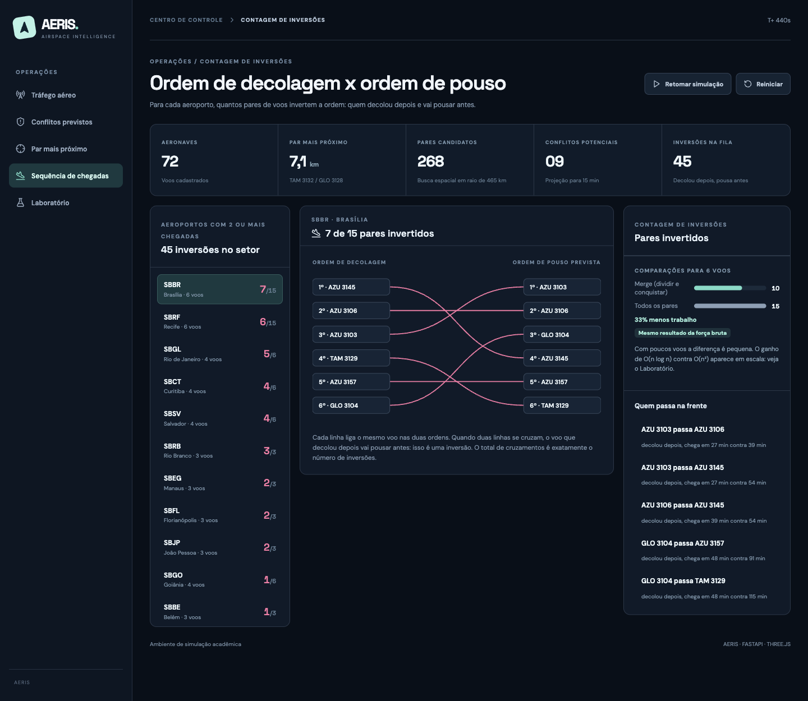
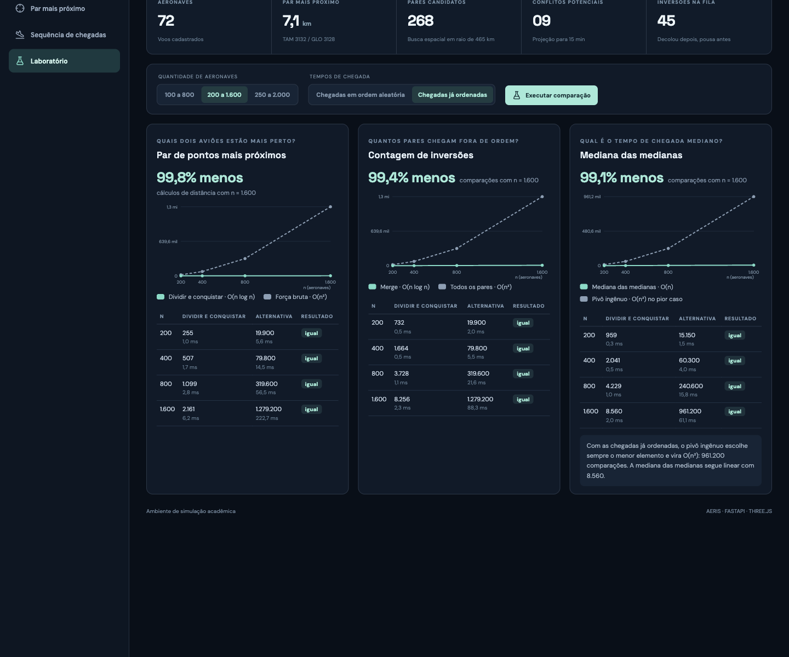

🇧🇷 **Português** | 🇺🇸 [English](README-eng.md)

<h1>AERIS - Simulador de Tráfego Aéreo com Dividir e Conquistar</h1>

## 🎥 Vídeo de demonstração

▶️ [Assista à demonstração do AERIS no YouTube](https://youtu.be/6HbT8gRPJSE)

<p align="center">
  <br><br>
  <br><br>
  <br><br>
  <br><br>
  
</p>

---

## Sobre

O AERIS é um simulador acadêmico de tráfego aéreo em 3D. Ele acompanha 72 voos sintéticos entre aeroportos de todas as regiões do Brasil e usa algoritmos de **dividir e conquistar** para responder perguntas que um controle de tráfego aéreo faz o tempo todo:

| Pergunta | Algoritmo | Onde fica | Complexidade | Comparado com |
| -- | -- | -- | -- | -- |
| Quais dois aviões estão mais perto agora? | Par de Pontos mais Próximos | [`closest_pair.py`](backend/app/divide_and_conquer/closest_pair.py) | O(n log n) | Força bruta, O(n²) |
| Quantos voos que decolaram depois vão pousar antes? | Contagem de Inversões | [`inversions.py`](backend/app/divide_and_conquer/inversions.py) | O(n log n) | Comparar todos os pares, O(n²) |
| Onde cortar o espaço aéreo ao meio sem ordenar os aviões? | Mediana das Medianas | [`median_of_medians.py`](backend/app/divide_and_conquer/median_of_medians.py) | O(n) | Pivô ingênuo, O(n²) no pior caso |

**Par de Pontos mais Próximos.** Os aviões são ordenados por x e por y uma única vez. A cada passo, uma linha vertical divide o grupo em duas metades iguais e o algoritmo resolve cada metade. Na combinação, só examina a faixa central de largura 2δ, em que δ é a melhor distância das metades, e compara cada avião com no máximo 7 vizinhos. Cada passo é registrado e reproduzido na tela.

**Contagem de Inversões.** Para cada aeroporto, os voos são colocados na ordem em que decolaram e comparados com a ordem prevista de pouso. Uma inversão é um par em que o voo que decolou depois vai pousar antes. A contagem é feita durante o merge: quando um voo da metade direita passa à frente, ele inverte com todos os que ainda restam na metade esquerda.

**Mediana das Medianas.** A busca de pares candidatos também divide e conquista. Para cortar cada grupo ao meio sem ordenar, ela usa a Mediana das Medianas: separa os aviões em grupos de 5, pega a mediana de cada grupo e usa a mediana dessas medianas como pivô. Isso garante encontrar o avião do meio em O(n).

O raio da busca é calculado a partir da maior velocidade da frota e da janela de 15 minutos (hoje, cerca de 465 km). Assim, até aviões que estão longe agora, mas podem se aproximar, são avaliados. Os pares candidatos passam por uma projeção de aproximação (CPA) de 15 minutos com separação vertical, que classifica os conflitos potenciais. Todo número exibido vem da execução real, e cada resultado é conferido contra a força bruta a cada atualização.

## Instalação

**Linguagem:** Python 3.12 (back-end) e TypeScript (front-end)<br>
**Framework:** FastAPI (back-end), React com Three.js e Vite (front-end)<br>

**Opção 1: Docker.** Pré-requisito: Docker com Docker Compose.

```bash
docker compose up --build
```

**Opção 2: sem Docker.** Pré-requisitos: Python 3.12 ou mais recente e Node.js 20 ou mais recente. Em um terminal, suba a API:

```bash
cd backend
python3 -m venv .venv
source .venv/bin/activate
pip install -r requirements.txt
uvicorn app.main:app --port 8000
```

Em outro terminal, suba a interface:

```bash
cd frontend
npm install
npm run dev
```

Nas duas opções:

- Interface: http://localhost:5173
- Documentação da API: http://localhost:8000/docs

Para rodar os 39 testes automatizados, em que cada algoritmo é comparado com a força bruta:

```bash
cd backend
pytest -q
```

## Uso

A simulação começa em movimento, em velocidade 20×. No menu lateral:

1. **Tráfego aéreo** (`#trafego`): gire o globo arrastando, use o scroll para dar zoom e clique em um avião para ver origem, destino, altitude, velocidade e chegada estimada. Os controles abaixo do globo pausam, mudam a velocidade (1×, 10×, 20× e 60×) e mostram ou ocultam rotas e identificações.
2. **Conflitos previstos** (`#conflitos`): pares encontrados pela busca espacial e avaliados pela projeção de 15 minutos. No globo, linhas âmbar ligam até 8 pares previstos.
3. **Par mais próximo** (`#par-mais-proximo`): congela um instante do tráfego e reproduz o algoritmo. Use **Reproduzir**, os botões de passo ou a linha do tempo, com velocidades de 0,5× a 4×. A fase *Dividir* mostra as linhas de corte, e a fase *Combinar* mostra a região, a faixa central e o melhor par. A aba **Mediana das medianas** mostra os cortes da busca por raio. **Capturar instante atual** congela um novo momento.
4. **Sequência de chegadas** (`#fila-de-pouso`): escolha um aeroporto à esquerda. Passe o mouse sobre um par em *Quem passa na frente* para destacar o cruzamento correspondente.
5. **Laboratório** (`#laboratorio`): escolha a quantidade de aeronaves e a ordem dos tempos de chegada e clique em **Executar comparação**. Com *Chegadas já ordenadas*, o pivô ingênuo degrada para O(n²) e a Mediana das Medianas continua linear.

Cada tela tem endereço próprio (por exemplo, http://localhost:5173/#laboratorio).

## Outros

### Estrutura do projeto

```text
backend/app/
├── main.py                       rotas da API
├── laboratory.py                 comparações em escala crescente
├── divide_and_conquer/
│   ├── closest_pair.py           par de pontos mais próximos (e força bruta)
│   ├── inversions.py             contagem de inversões (e força bruta)
│   └── median_of_medians.py      mediana das medianas (e pivô ingênuo)
└── airspace/
    ├── simulation.py             movimento dos voos e montagem dos snapshots
    ├── proximity.py              busca por raio dividida pela mediana e CPA
    ├── landing_sequence.py       sequência de chegadas por aeroporto
    ├── geography.py              aeroportos e projeção plana regional
    ├── flight_repository.py      leitura do banco SQLite
    └── flight_routes.sqlite3     72 voos sintéticos
frontend/src/
├── App.tsx                       navegação e ciclo da simulação
├── globe/                        globo 3D (Three.js)
├── traffic/                      telas de tráfego e conflitos
├── algorithms/                   radar 2D e reprodutor de passos
├── landing/                      sequência de chegadas
└── laboratory/                   laboratório de desempenho
```

### Resultados do laboratório (n = 1.600)

| Algoritmo | Dividir e conquistar | Alternativa ingênua |
| -- | -- | -- |
| Par de Pontos mais Próximos | 2.161 cálculos de distância | 1.279.200 |
| Contagem de Inversões (chegadas aleatórias) | 15.045 comparações | 1.279.200 |
| Mediana das Medianas (chegadas já ordenadas) | 8.560 comparações | 961.200 |
| Mediana das Medianas (chegadas aleatórias) | 12.473 comparações | 5.170 |

A última linha mostra um caso em que o dividir e conquistar perde. Com dados aleatórios, o pivô ingênuo costuma acertar e gasta menos. A vantagem da Mediana das Medianas é a garantia de O(n) também no pior caso.

### Como as comparações são medidas

A métrica principal é a quantidade de operações (cálculos de distância ou comparações), que não depende da máquina. O tempo em milissegundos aparece como complemento. Na busca por raio, o total do dividir e conquistar soma os cálculos de distância e as comparações gastas para achar as medianas.

### Limitações

- Os dados são sintéticos. O movimento usa interpolação linear na projeção regional e rotas visuais em arco no globo, sem aerovias, ventos ou procedimentos reais.
- Ao concluir a rota, a aeronave reinicia no ponto de origem para manter a demonstração contínua.
- A altitude é constante, a previsão CPA assume velocidade constante e as distâncias usam aproximação plana regional. Os limites de conflito são apenas didáticos.
- A API mantém o estado da simulação em memória e assume uma única sessão compartilhada.
- Não é software aeronáutico certificado e não deve ser usado para decisões reais.

---

## Colaboradores

| [Camila Cavalcante](https://github.com/CamilaSilvaC) | [Luísa Ferreira](https://github.com/luisa12ll) |
| :---: | :---: |
|  |  |
